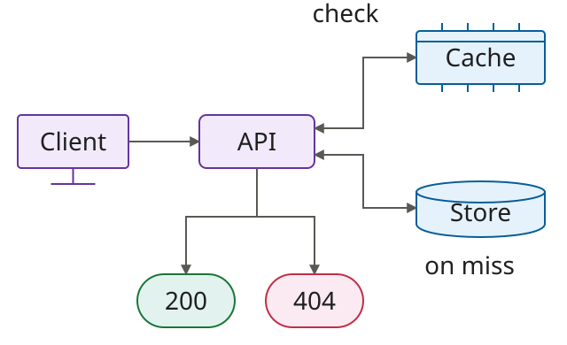
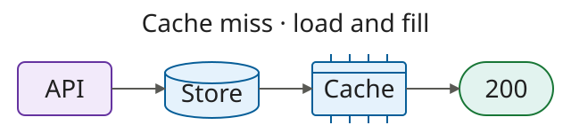

# fix: load the record when the cache misses

## Problem & Solution Overview

An empty cache returns “not found” for an existing record. Read the store on a miss, populate the cache, and return the record. The next request reads from the cache.



## Testing Done

> Illustrative transcript for a fictional Rust application. These commands and outputs are examples, not an executed test run.

<details>
<summary>Local setup</summary>

Start the Rust service with fixture 42 present, fixture 999 absent, and an empty cache:

```sh
RUST_LOG=info cargo run -- --fixture record-42
```

</details>

### First request · cold cache



<details>
<summary>Commands and results</summary>

```sh
curl -i http://localhost:3000/records/42
```

```http
HTTP/1.1 200 OK
content-type: application/json

{"id":42,"name":"Example record"}
```

The service emits one cache-fill log:

```text
INFO cache_miss record_id=42 source=store cache_populated=true
```

</details>

### Second request · warm cache


<details>
<summary>Commands and results</summary>

```sh
curl -i http://localhost:3000/records/42
```

```http
HTTP/1.1 200 OK
content-type: application/json

{"id":42,"name":"Example record"}
```

Same response; no new cache-miss or cache-fill log. The record is already cached.

</details>

### Missing record · 404


<details>
<summary>Commands and results</summary>

```sh
curl -i http://localhost:3000/records/999
```

```http
HTTP/1.1 404 Not Found
content-type: application/json

{"error":"record not found"}
```

No record is cached and no cache-populated log is emitted.

</details>

**Limit:** Log absence alone does not prove there was no store read. Check the store-read count stays at one before making that claim. Store failures and simultaneous misses are outside this example.

<details>
<summary>Evidence to capture in a real PR</summary>

Record the reviewed commit, Rust version, launch command, all three responses, and service logs. Confirm the warm request adds no store read and the missing record adds no cache fill.

</details>
