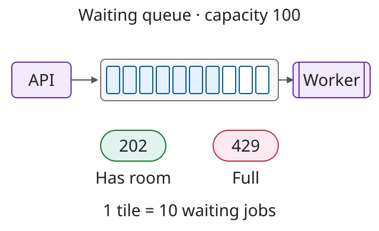
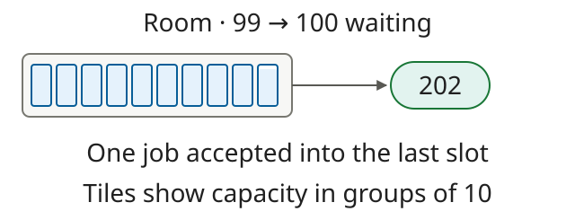
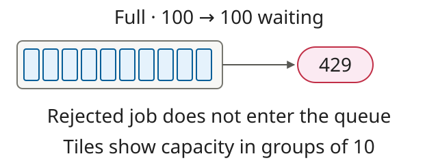
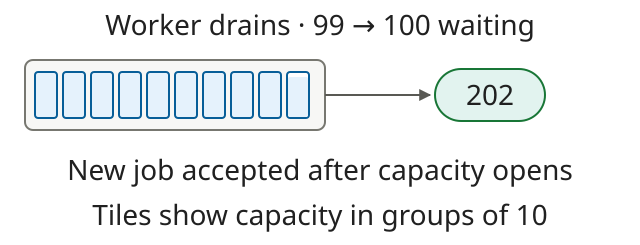

# fix: reject new jobs when the queue is full

## Problem & Solution Overview

A stalled worker allows pending jobs to accumulate. Cap the waiting queue at 100 jobs and return 429 for new work until a slot opens. Running jobs are counted separately.



## Testing Done

> Illustrative transcripts for fictional applications. These commands and outputs are examples, not an executed test run.

<details>
<summary>Local setup</summary>

```sh
docker compose up -d api worker
docker compose pause worker
node scripts/submit-jobs.mjs --count 99 --concurrency 1
```

Start from an empty isolated queue. Run these three scenarios in order. The worker stays paused for the first two.

</details>

### Accept the last available slot



<details>
<summary>Commands and results</summary>

```sh
curl -i -X POST http://localhost:3000/jobs \
  -H 'Content-Type: application/json' -d '{"id":"job-100"}'
curl http://localhost:3000/debug/queue
```

```text
HTTP/1.1 202 Accepted
{"id":"job-100","status":"queued"}
Queue: {"waiting":100,"capacity":100}
```

</details>

### Reject work when full



<details>
<summary>Commands and results</summary>

```sh
curl -i -X POST http://localhost:3000/jobs \
  -H 'Content-Type: application/json' -d '{"id":"job-101"}'
curl http://localhost:3000/debug/queue
```

```text
HTTP/1.1 429 Too Many Requests
{"error":"queue full"}
Queue: {"waiting":100,"capacity":100}
```

</details>

### Accept work after the worker drains



<details>
<summary>Commands and results</summary>

Resume the worker, then pause it once the isolated queue reports 99 waiting jobs. Verify that fixture state before retrying.

```sh
docker compose unpause worker
# After observing waiting=99, pause the worker again.
docker compose pause worker
curl http://localhost:3000/debug/queue
curl -i -X POST http://localhost:3000/jobs \
  -H 'Content-Type: application/json' -d '{"id":"job-101"}'
curl http://localhost:3000/debug/queue
```

```text
Before retry: {"waiting":99,"capacity":100}
HTTP/1.1 202 Accepted
{"id":"job-101","status":"queued"}
After retry: {"waiting":100,"capacity":100}
```

Restore the local worker after the check:

```sh
docker compose unpause worker
```

</details>

**Limit:** A serial scenario does not prove the cap under concurrent admission. Check concurrent submissions separately. Pausing a running worker may overshoot the target; reset the fixture if it is not at 99.
