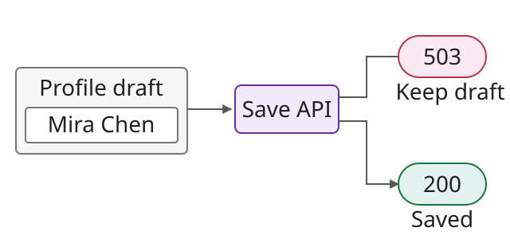

# fix: preserve form inputs when saving fails

## Problem & Solution Overview

A failed save clears the edited profile. Retain the draft and offer Retry so the user can submit again without retyping.



## Testing Done

> Illustrative transcripts for fictional applications. These commands and outputs are examples, not an executed test run.

<details>
<summary>Local setup</summary>

```sh
npm ci
npm run dev
```

Use an isolated profile fixture. Enter “Mira Chen” in /profile. The test routes below control the response for each scenario.

</details>

### Successful save


<details>
<summary>Commands and results</summary>

Click Save with the profile endpoint available. Confirm the saved name after reloading.

```sh
npx playwright test tests/profile-retry.spec.ts --grep "successful save"
```

```text
PATCH /api/profile → 200 OK
Visible status: Saved
Reloaded profile: Mira Chen
1 passed (illustrative)
```

</details>

### Failed save preserves the draft


<details>
<summary>Commands and results</summary>

Mock PATCH /api/profile to return 503, then click Save.

```sh
npx playwright test tests/profile-retry.spec.ts --grep "retains draft"
```

```text
PATCH /api/profile → 503 Service Unavailable
Input value: Mira Chen
Visible action: Retry
1 passed (illustrative)
```

</details>

### Retry saves the retained draft


<details>
<summary>Commands and results</summary>

Fail the first PATCH with 503, then allow the next PATCH. Click Retry without retyping; reload to confirm the saved profile.

```sh
npx playwright test tests/profile-retry.spec.ts --grep "retry succeeds"
```

```text
First PATCH → 503 Service Unavailable
Retry body: {"name":"Mira Chen"}
Second PATCH → 200 OK
Reloaded profile: Mira Chen
1 passed (illustrative)
```

</details>

**Limit:** Does not cover navigation away, refresh recovery, or duplicate submissions after an ambiguous network timeout.
