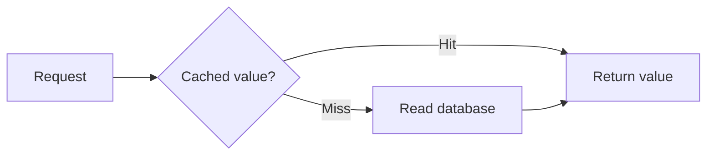
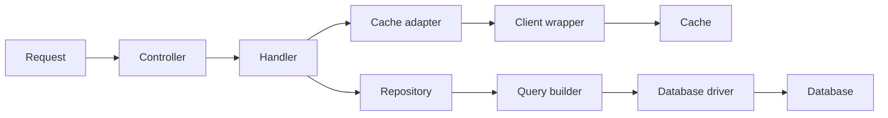

# Mermaid for a small review figure

Use native Mermaid when a relationship matters more than exact drawing geometry.
Prefer a small supported syntax subset and the host's light/dark theme. Do not force
custom colors that become unreadable in the opposite theme. If precise theme tokens
or exported image geometry are required, choose SVG instead.

## Good: one reviewer question

Question: what happens on a cache miss?

Caption: A miss reads the database before returning a value. Cache fill and error
handling are omitted from this conceptual read-path figure.

Why it works: every branch has a named condition, arrow direction matches the order
of work, and the omitted scope is explicit. The reader does not need a legend to
decode colors. This is a conceptual flow, not a claim about a particular repository.

## Bad: a box for every implementation detail

This may be useful for an implementation walkthrough, but it fails the cache-miss
question: it omits the branch condition while adding abstractions the reader does
not need. Repair by preserving the decision and collapsing irrelevant layers.
Do not label a detailed diagram universally bad; judge it against its intended question.

## Delivery checks

Render with the destination's supported Mermaid version. Check both supported themes,
label wrapping, branch meaning, and embedded width. A syntactically valid graph can
still communicate the wrong thing. For GitHub, keep the Mermaid block in the PR body
and inspect the published rendering when publication is authorized. The format reference
is [GitHub diagrams](https://docs.github.com/en/get-started/writing-on-github/working-with-advanced-formatting/creating-diagrams).
